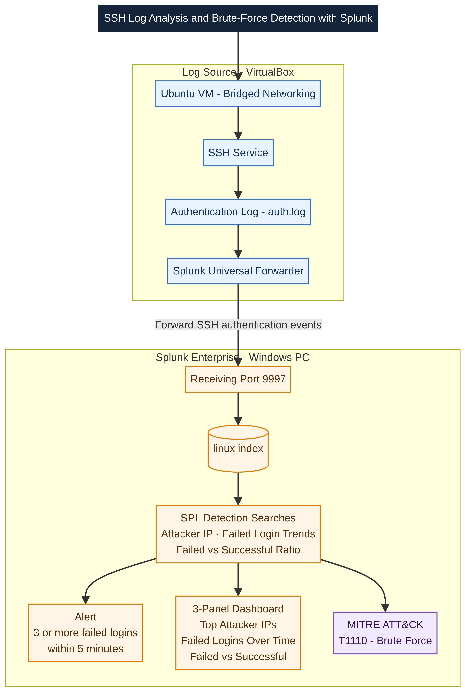
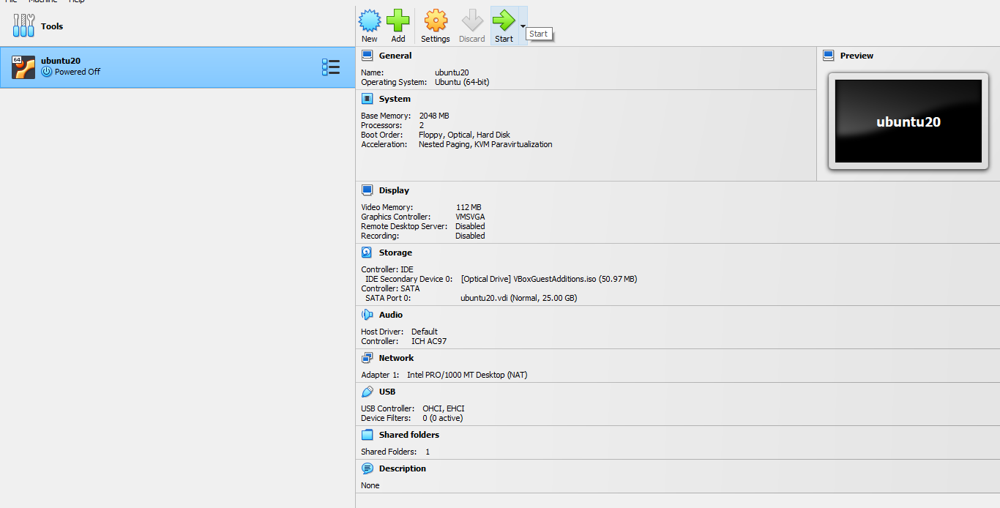
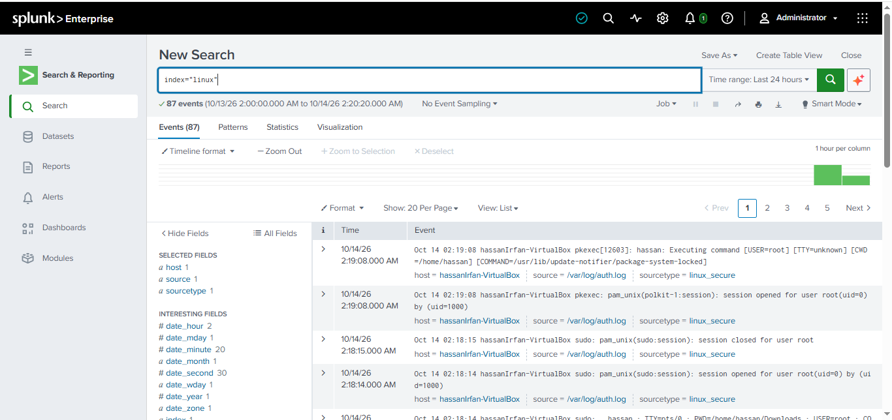
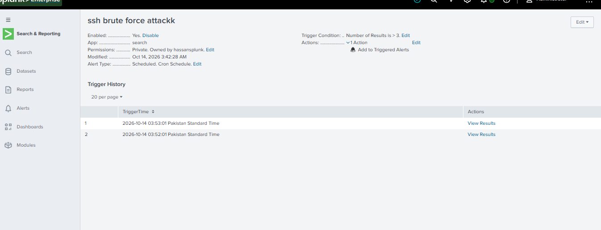
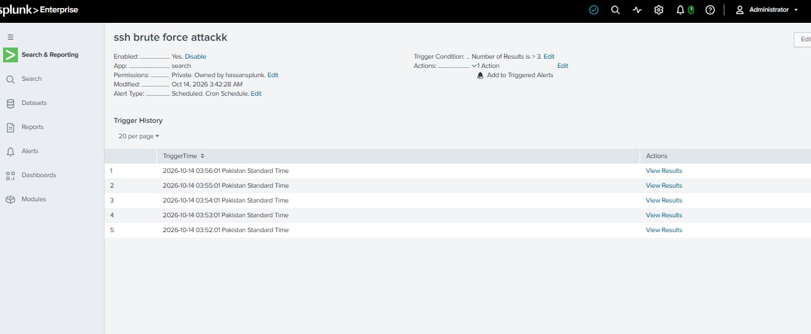

# SSH Log Analysis & Brute-Force Detection Using Splunk SIEM

## Overview

A hands-on defensive security lab that forwards Ubuntu SSH authentication logs to Splunk, investigates failed logins, and detects repeated attempts with an alert and dashboard.

## Architecture



## Lab Environment

- VirtualBox and Ubuntu VM with bridged networking
- SSH service and `/var/log/auth.log`
- Splunk Universal Forwarder on Ubuntu
- Splunk Enterprise on Windows
- Receiver port: `9997`; index: `linux`

## Project Steps and Evidence

### 1. Set up the Ubuntu VM and verify SSH connectivity
Created the Ubuntu VM, configured networking, and tested SSH connectivity to the lab host.




### 2. Install and configure the Universal Forwarder
Installed Splunk Universal Forwarder and configured it to monitor `/var/log/auth.log` and send events to Splunk Enterprise on port `9997`.

### 3. Generate failed SSH authentication events
Generated failed SSH password attempts in the isolated lab to create detection test data.

### 4. Search and analyze SSH logs with SPL
Used Splunk searches to identify source IPs, review failed-login patterns over time, and compare failed and successful logins.

**Failed attempts by source IP**

```spl
index=linux "Failed password"
| rex "from (?<src_ip>\d{1,3}(?:\.\d{1,3}){3})"
| stats count AS failed_attempts BY src_ip
| sort - failed_attempts
```

**Failed logins over time**

```spl
index=linux "Failed password"
| timechart span=5m count AS failed_logins
```

**Failed versus successful logins**

```spl
index=linux ("Failed password" OR "Accepted password")
| eval result=if(searchmatch("Failed password"), "Failed", "Successful")
| stats count BY result
```



### 5. Create and test the brute-force alert
Configured and tested an alert for **3 or more failed logins within five minutes**.

```spl
index=linux "Failed password"
| rex "from (?<src_ip>\d{1,3}(?:\.\d{1,3}){3})"
| bin _time span=5m
| stats count AS failed_attempts BY _time src_ip
| where failed_attempts >= 3
```




### 6. Build the dashboard
Created a three-panel dashboard for Top Attacker IPs, Failed Logins Over Time, and Failed vs Successful Logins. The last octet of displayed IPs is masked.


### 7. Map the detection
Mapped repeated password-guessing behavior to **MITRE ATT&CK T1110 — Brute Force**.

## Privacy

The screenshots are restored from the project document. Only the final octet of visible private IP addresses is masked; browser tabs/address bars and the Word toolbar are cropped where present. No broad black overlays are used.

## Scope

All login attempts were generated in an isolated lab for defensive detection testing.
